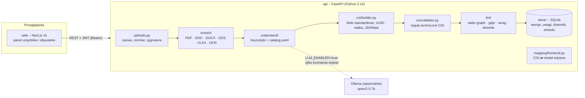
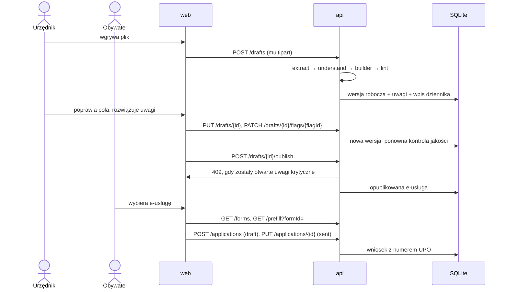

# Architektura e-Formularzy

Dokument opisuje stan faktyczny kodu. Plan i uzasadnienia decyzji są w [`BACKEND_PLAN.md`](../BACKEND_PLAN.md),
a szczegóły uruchomienia w [`apps/api/README.md`](../apps/api/README.md) i [`apps/web/README.md`](../apps/web/README.md).

## Komponenty



Przepływ w jednym żądaniu konwersji (`app/pipeline.py`):
`extract → understand → llm.refine (opcjonalnie) → coi.builder → lint (w tym validator) → wynik`.
Ścieżka `/drafts` dodatkowo zapisuje wynik w SQLite, a `/api/v1/convert` tylko go zwraca.

| Moduł | Rola |
| --- | --- |
| `app/uploads.py` | Biała lista rozszerzeń, zgodność sygnatury z rozszerzeniem, limit rozmiaru i rozpakowania (ochrona przed „bombą ZIP”) |
| `app/extract/` | Sprowadza każdy format do `DocumentIR` (linie z numerem strony). OCR: Tesseract, DOC: LibreOffice |
| `app/understand/` | Rozpoznaje sekcje, pola, typy, walidacje, warunki i słowniki na regułach z `catalog.yaml`. `llm.py` przy włączonym modelu poprawia wyłącznie etykiety |
| `app/coi/` | Buduje JSON COI (`builder.py`), sprawdza reguły techniczne (`validator.py`), generuje i parsuje zapytania JSONata (`jsonata.py`) |
| `app/lint/` | Uwagi w trzech stopniach (`error`, `warning`, `info`): graf przejść i warunki, minimalizacja danych (RODO), prosty język i dostępność, podpowiedzi słowników |
| `app/mapping/frontend.py` | Tłumaczy COI na model edytora i z powrotem, zachowując klucze, których edytor nie zna |
| `app/store/db.py` | SQLite: wersje robocze, decyzje w sprawie uwag, opublikowane e-usługi, wnioski, dziennik z łańcuchem SHA-256 |
| `app/security.py` | Tokeny JWT (HS256), role `official` i `citizen`, konta demonstracyjne |

Kanoniczny model to **JSON COI + `meta`** (mapa `fieldId → {legalBasis, confidence, sourceSpan}`).
`meta` nigdy nie trafia do eksportu COI (`GET /drafts/{id}/coi`).

## Przepływ danych: od blankietu do wniosku



## Punkty końcowe

Pełna specyfikacja: `GET /docs` (OpenAPI). Błędy w formacie `application/problem+json` (RFC 9457) z polskimi komunikatami.

| Grupa | Ścieżki | Rola |
| --- | --- | --- |
| System | `GET /health`, `POST /auth/token`, `GET /me`, `GET /dictionaries[/{nazwa}]` | publiczne (`/me` – zalogowany) |
| Konwersja | `POST /api/v1/convert`, `POST /api/v1/convert/batch` (do 20 plików, ZIP) | urzędnik |
| Edytor | `POST/GET /drafts`, `GET/PUT /drafts/{id}`, `GET/PUT /drafts/{id}/coi`, `POST /coi/import` | urzędnik |
| Kontrola jakości | `POST /drafts/{id}/lint`, `PATCH /drafts/{id}/flags/{flagId}`, `POST /drafts/{id}/publish` | urzędnik |
| Dziennik | `GET /audit?draftId=`, `GET /audit/verify` | urzędnik |
| Przepisy | `GET /drafts/{id}/statute-chunks` – na razie zwraca tylko podstawy prawne odczytane z formularza | urzędnik |
| Obywatel | `GET /forms[/{id}]` (każda rola), `GET /prefill?formId=`, `GET/POST /applications`, `GET/PUT /applications/{id}` | obywatel |

## Bezpieczeństwo

- **Uwierzytelnianie.** JWT HS256 z polami `sub`, `role`, `exp`, `iss`. Uprawnienia wymusza zależność FastAPI
  (`Official`, `Citizen`, `AnyUser`); zła rola to 403, brak lub zły token to 401.
- **Sekret JWT** pochodzi z `JWT_SECRET` albo z pliku `JWT_SECRET_FILE` (Docker secrets). Przy `AUTH_ENABLED=true`
  brak sekretu zatrzymuje start z komunikatem, jak go utworzyć (`./scripts/make-secrets.sh`). Sekret nie trafia do obrazu.
- **Pliki** są przetwarzane w pamięci. LibreOffice i Tesseract dostają kopię w katalogu tymczasowym, usuwaną po konwersji.
  W bazie zostaje nazwa pliku i skrót SHA-256. Walidacja: biała lista rozszerzeń, sygnatura, nazwa bez znaków specjalnych,
  limity rozmiaru, liczby stron i rozpakowania.
- **Dziennik decyzji** jest łańcuchem skrótów SHA-256; `GET /audit/verify` wykrywa zmianę historii.
- **Wnioski** są widoczne tylko dla właściciela (cudzy wniosek zwraca 404), a wysłanego wniosku nie można zmienić (409).
- **CORS** dopuszcza tylko adresy z `CORS_ORIGINS`, bez ciasteczek (`allow_credentials=False`).
- **Brak zewnętrznych API.** Model językowy działa lokalnie w Ollamie i jest opcjonalny; strukturę formularza zawsze buduje kod.

## Wdrożenie

`docker-compose.yml` w katalogu głównym uruchamia:

| Usługa | Obraz | Port | Uwagi |
| --- | --- | --- | --- |
| `api` | `python:3.14.9-alpine3.24` + Tesseract (pol) + LibreOffice Writer | `8000` | użytkownik `app` (UID 10001), wolumen `api-data` na `/data` (SQLite) |
| `web` | `node:24.22.3-alpine3.24`, serwer standalone Next.js | `5173 → 8080` | `NEXT_PUBLIC_API_URL` wkompilowany w czasie budowania |
| `ollama` | `ollama/ollama` | brak | tylko w profilu `llm` |

Kontenery `api` i `web` mają system plików tylko do odczytu (`read_only: true`, zapis wyłącznie na `tmpfs` i wolumenie),
`cap_drop: ALL` i `no-new-privileges`. Sekret JWT montowany jest jako Docker secret z `secrets/jwt_secret.txt`.

```bash
./scripts/make-secrets.sh
docker compose up -d --build                      # web: http://localhost:5173, api: http://localhost:8000/docs
LLM_ENABLED=true docker compose --profile llm up -d
```

## Układ monorepo

```
apps/
  api/            backend FastAPI (app/, tests/, scripts/, data/, Dockerfile, requirements*.txt, ruff.toml)
  web/            frontend Next.js (src/app, src/features, src/api – klient HTTP i makiety)
packages/
  brand/          logo, kolory i materiały marki
docs/             dokumentacja przekrojowa (ten plik)
scripts/          skrypty repozytorium (make-secrets.sh)
data-pdf/         przykładowe blankiety z wyzwania (używane w testach)
outputs/          wyniki scripts/batch_convert.py
docker-compose.yml
BACKEND_PLAN.md
```
